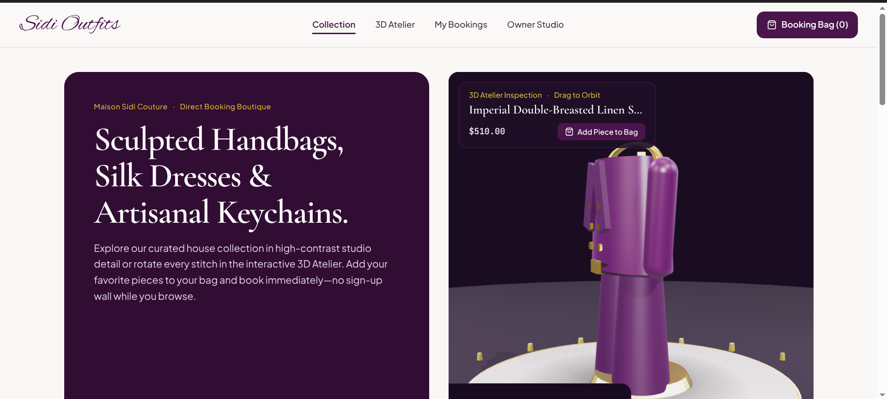

<div align="center">

</div>

# Run and deploy your AI Studio app

This contains everything you need to run your app locally.

```bash
npm install --force
npm install --legacy-peer-deps ```


## Run Locally

**Prerequisites:**  Node.js, Reactvite, three js


1. Install dependencies:
   `npm install`
2. Set the `GEMINI_API_KEY` in [.env.local](.env.local) to your Gemini API key
3. Run the app:
   `npm run dev`
